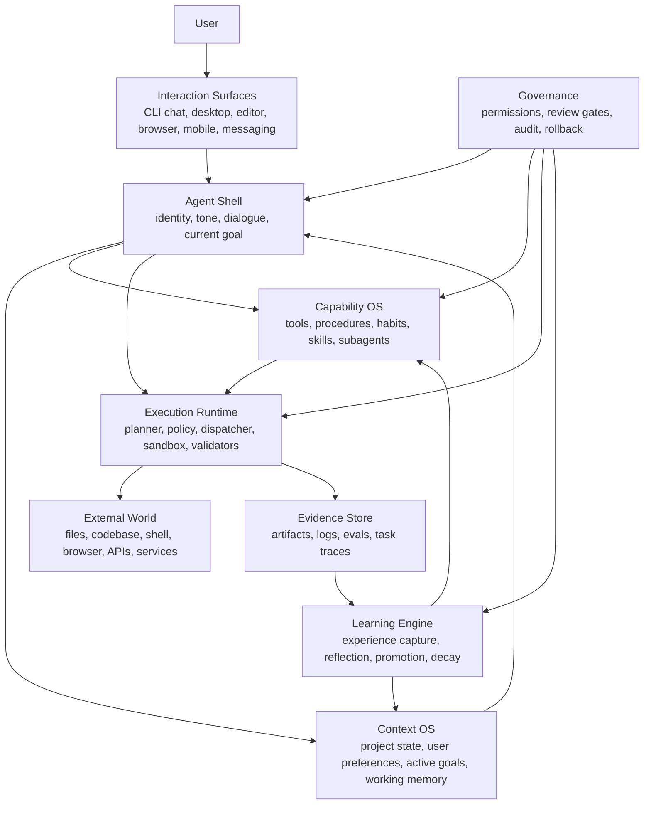
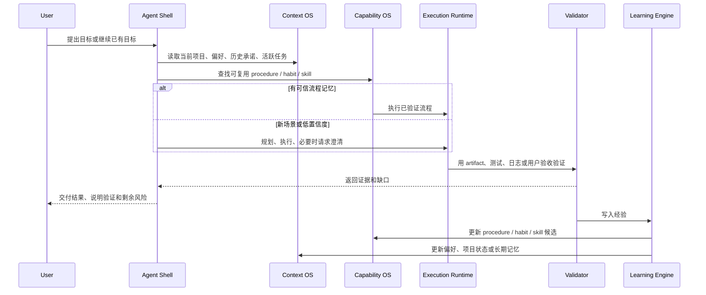
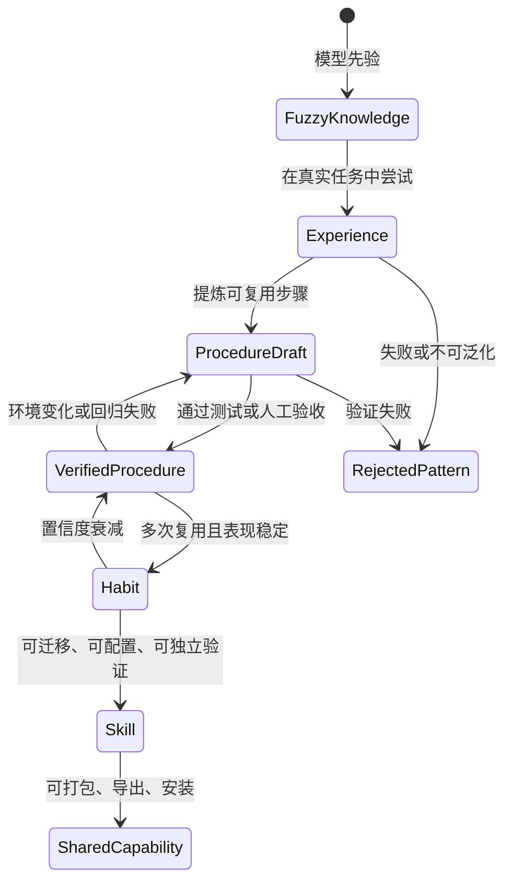
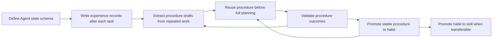

# OmniAgent 产品整体架构设计

Last reviewed: 2026-06-10

## 文档状态

- Document type: product architecture / design strategy
- Workstream: smart learning agent redesign
- Document status: active
- Implementation status: not_started
- Authority scope: 目标产品架构、设计思想、后续路线取舍
- Current implementation source: `ARCHITECTURE.md` and code under `src/omniagent/`

本文描述 OmniAgent 下一阶段应该成为怎样的产品。它不是当前代码已经实现的事实；当前事实仍以 `ARCHITECTURE.md`、`ROADMAP.md`、`issue.md` 和代码为准。

## 设计结论

OmniAgent 不应该继续只被定义为 task-centric runtime。它的目标产品形态应该是一个本地优先、可审计、会学习的个人 Agent：

- 能理解用户当前项目、历史偏好、正在推进的目标和常用工作方式。
- 能把一次次任务执行沉淀为经验、流程记忆、习惯和可迁移 skill。
- 能在重复任务上变快、变稳、少问废话，在新任务上暴露不确定性并主动验证。
- 能让用户检查、编辑、禁用和迁移它学到的内容。
- 能完成真实任务，而不是只展示一个可运行的任务编排内核。

一句话定位：

> OmniAgent 是一个以学习循环为中心的个人 Agent OS；Task runtime 是执行层，不是产品中心。

## 当前偏离点

当前实现的优势是可审计、可调试、模块边界清晰，但它更像一个任务执行引擎，而不是一个“看起来聪明、会自我学习、能持续帮我做事”的 Agent。

| 偏离点 | 当前表现 | 目标表现 |
|---|---|---|
| 产品中心 | `TaskGraph`、Planner、ExecutionEngine 是主轴 | 用户目标、上下文连续性、学习结果是主轴 |
| 记忆定义 | 多路 recall，把材料塞回上下文 | 行为会被记忆改变，记忆能升级为 procedure / habit / skill |
| 学习方式 | workflow compiler 和 skill lifecycle 偏工程沉淀 | 从任务经验中提炼可验证的流程记忆，并在下次任务优先复用 |
| 聪明感 | 每次重新规划、重新解释、重新验证 | 识别熟悉场景，使用已学流程，知道何时少想、何时深想 |
| 交互关系 | 用户提交 task，runtime 返回结果 | 用户和 Agent 共处一个长期工作现场，Agent 维护目标、状态和偏好 |
| 能力演进 | 增加 builtin skill 或 executor | 经验先变成 procedure，再通过验证升级成 habit / skill |
| 安全治理 | 权限和沙箱主要保护执行动作 | 用户可审计学习内容、能力升级和自主行为边界 |

## 参考产品设计思想

### Codex

Codex 的关键启发不是“会写代码”，而是把 Agent 当成一个带工作记忆、权限边界和可并行协作能力的 teammate：

- [Memories](https://developers.openai.com/codex/memories) 把有用上下文从过往线程沉淀到本地记忆文件，但不把短期会话全部永久化。
- [Subagents](https://developers.openai.com/codex/concepts/subagents) 用专门 agent 并行处理读多写少的探索任务，避免主上下文污染。
- [Workflows](https://developers.openai.com/codex/workflows) 强调给 Agent 明确上下文和 definition of done，像协作同事一样工作。
- [Permissions](https://developers.openai.com/codex/permissions) 把工作区、网络、写入和敏感路径纳入明确治理，而不是让模型自由行动。

对 OmniAgent 的启发：学习记忆必须是本地、可审计、可修订的；复杂任务需要分工，但主 Agent 必须保持目标和上下文稳定；权限是产品体验的一部分。

### Claude Code

Claude Code 的关键启发是“工程工作现场感”：它不仅接收 prompt，还读代码库、编辑文件、运行命令、使用项目指令、沉淀记忆和技能，并跨终端、IDE、Web、CI、Slack 等工作面协作。

对 OmniAgent 的启发：

- 项目规则、用户偏好、技能和 hook 应该是一等输入，而不是附加 prompt。
- 同一个 Agent 能力要跨不同入口保持一致，不能每个入口都是一次性会话。
- 自动化不只发生在单次命令里，也可以发生在 recurring task、后台任务和远程协作场景里。

参考：[Claude Code overview](https://code.claude.com/docs/en/overview)

### OpenClaw

OpenClaw 的关键启发是“产品不是 gateway，而是个人助手”。它把 Gateway 当作控制平面，把多渠道 inbox、语音、Canvas、工具、技能和本地优先部署组织成一个始终可用的个人助理。

对 OmniAgent 的启发：

- Runtime / Gateway 只是控制面，用户感知到的产品应该是 assistant。
- 多入口不是锦上添花；它决定 Agent 是否能真正融入用户工作流。
- 本地优先、配对、安全默认值和非主会话 sandbox 是个人 Agent 的基础信任机制。

参考：[OpenClaw README](https://github.com/openclaw/openclaw)

## 目标产品架构

这张图里，`ExecutionRuntime` 仍然重要，但它只是执行层。产品的聪明感来自 `AgentShell + ContextOS + CapabilityOS + LearningEngine` 共同形成的闭环。

## 核心行为闭环

关键要求：学习必须发生在验证之后。没有证据的成功不能升级为习惯或 skill，只能记录为经验候选。

## 学习分层

用户提出的“模型本身知识技能像模糊记忆，工程化设计记忆像反复练习后验证的知识技能”可以落成以下分层：

| 层级 | 含义 | 进入条件 | 行为影响 |
|---|---|---|---|
| Fuzzy knowledge | 模型先验和泛化能力 | 模型本身具备 | 可用于推理，但不能直接当项目事实 |
| Experience | 某次任务的上下文、动作、结果和证据 | 每次任务结束后记录 | 支持复盘和相似场景召回 |
| Procedure draft | 从经验中抽出的步骤草案 | 出现可重复模式 | 下次可建议复用，但需要谨慎验证 |
| Verified procedure | 经过测试、artifact 或用户确认的流程 | 有明确成功证据 | 可优先于重新规划 |
| Habit | 多次稳定复用的流程记忆 | 多次成功、低回归率 | 快速执行，减少不必要提问和 LLM 调用 |
| Skill | 可配置、可迁移、可独立验证的能力包 | 有契约、测试和边界 | 可导出、升级、安装、分享 |

## 关键子系统

### Agent Shell

负责让用户感知到“这是同一个 Agent”：

- Agent identity: 名称、角色、边界、默认沟通方式。
- Dialogue state: 当前线程、最近承诺、待确认事项、阻塞原因。
- Goal state: 用户当前真正想达成的目标，而不是单条 prompt。
- Self model: Agent 知道自己会什么、不会什么、哪些能力刚学会、哪些能力不稳定。

没有 Agent Shell，系统只能执行命令；有了 Agent Shell，用户才会觉得它在协作。

### Context OS

负责维护“我在哪个工作现场”：

- Project state: 当前仓库、活跃 workstream、开放 issue、文档权威边界。
- User preferences: 用户长期偏好、输出风格、验证标准、常见禁忌。
- Working memory: 当前目标所需的短期上下文。
- Episodic memory: 已完成任务的过程、证据和结果。
- Semantic memory: 项目事实、架构知识、术语和规则。
- Procedural memory: 可复用步骤、习惯和 skill 索引。

Context OS 不是向量库的同义词。向量召回只是其中一种索引方式，核心是 typed memory、权威边界和可修订性。

### Capability OS

负责回答“现在应该用什么能力做事”：

- Tool: 原子工具，例如文件、shell、git、browser、HTTP。
- Executor: 稳定的动作执行器，有输入输出契约。
- Procedure: 多步流程记忆，通常来自经验提炼。
- Habit: 高置信度 procedure，可以走 fast path。
- Skill: 可迁移能力包，带说明、边界、验证和版本。
- Subagent: 为隔离上下文或并行探索而启动的专门执行单元。

Capability OS 要记录能力成熟度，而不是只记录能力是否存在。

### Learning Engine

负责让 Agent 真的变强：

1. Capture: 记录任务目标、环境、输入、动作、结果、证据和失败。
2. Reflect: 判断哪些步骤可复用，哪些只是偶然成功。
3. Extract: 生成 procedure draft 或偏好更新候选。
4. Validate: 用测试、artifact、日志、用户确认或评测验证。
5. Promote: 经验升级为 procedure、habit 或 skill。
6. Decay: 长期未使用、失败或环境变化的记忆降级。
7. Explain: 向用户说明“我这次复用了什么经验，学到了什么”。

Learning Engine 的输出必须可审计、可撤销、可编辑。

### Execution Runtime

当前 `EmbeddedRuntime`、Planner、ExecutionEngine、Dispatcher、Critic、CompletionEvaluator、Sandbox、PermissionManager 仍然保留，但职责应下沉为执行层：

- 接收明确目标、流程或 plan。
- 按权限和 policy 执行动作。
- 产生 artifact、trace、diagnostics 和验证证据。
- 在失败时暴露结构化原因。

它不再单独承担“产品聪明感”。

### Governance

个人 Agent 的学习和自主能力必须受治理：

- 用户可查看 Agent 学到的 memory、procedure、habit 和 skill。
- 用户可禁用、编辑、删除或迁移学习内容。
- 远端写入、真实账号、付费 API、生产数据和不可逆操作必须显式确认。
- 自动升级能力需要证据门槛。
- 高风险任务默认只读分析，直到用户授权。

## 当前模块映射

| 目标架构模块 | 当前可复用基础 | 需要调整 |
|---|---|---|
| Agent Shell | `interaction.py`、`response_generator.py`、thread/checkpoint | 增加 Agent identity、current goal、self model、承诺追踪 |
| Context OS | `memory.py`、`graph_memory.py`、`hybrid_memory.py`、`vector_recall.py`、workspace memory | 从 recall 系统升级为 typed memory 和权威边界系统 |
| Capability OS | `skill_registry.py`、builtin skills、`workflow_compiler.py`、`skill_lifecycle.py` | 引入 procedure / habit 概念和能力成熟度 |
| Learning Engine | `workflow_compiler.py`、`skill_auto_generation.py`、eval artifacts | 改成经验捕获、反思、提炼、验证、升级闭环 |
| Execution Runtime | `runtime.py`、`execution_engine.py`、`dispatcher.py`、`execution_policy.py` | 下沉为执行层，优先执行可信流程，必要时才完整规划 |
| Governance | `permissions.py`、`sandbox.py`、policy artifact | 覆盖学习内容、能力升级、跨入口自主行为 |
| Evidence Store | `workspace/tasks/`、`eval_runs/`、LLM logs、diagnostics | 建立统一 evidence schema，服务学习升级和回归验证 |

## 新的 MVP 主线

此前 `META-009` 解决的是 runtime 效率问题，已经归档为旧实现迁移输入。若目标是做一个好用的 Agent，当前产品主线应切换为：

> `META-010` Agent usability and learning loop MVP

### Phase 1: Agent state

新增最小 Agent 状态模型：

- `AgentProfile`: Agent 名称、定位、能力边界和默认沟通方式。
- `UserPreference`: 用户偏好、验证标准、输出风格和长期禁忌。
- `ProjectState`: 当前仓库目标、活跃 workstream、重要文档和开放问题。
- `CurrentGoal`: 正在推进的目标、完成定义、阻塞项、下一步。
- `ExperienceRecord`: 任务过程、动作、证据、结果、失败归因。

验收标准：用户问“现在这个项目问题在哪”时，Agent 能结合当前文档、issue、运行证据和历史偏好给出有依据的判断，而不是泛泛解释 Agent 架构。

### Phase 2: Procedure memory

把成功任务提炼为 procedure draft：

- procedure 有名称、触发条件、步骤、输入输出、验证方式、风险边界。
- 下次遇到相似任务时，先展示“我识别到可复用流程”，再执行或请求确认。
- procedure draft 不直接等于 skill，必须经过验证。

验收标准：重复做文档治理、评测诊断、GitHub 发布、浏览器填表等任务时，Agent 能明显减少重新探索。

### Phase 3: Habit fast path

把多次成功的 verified procedure 升级为 habit：

- 低风险 habit 可直接执行并汇报。
- 中风险 habit 先说明将复用哪个流程，再请求确认。
- 高风险行为仍必须权限确认。

验收标准：简单、熟悉、低风险任务不再全量走 Planner -> Critic -> Completion，而是走 procedure runner + validator。

### Phase 4: Skill promotion

只有当 habit 稳定、边界清楚、需要迁移或分享时，才升级为 skill：

- skill 必须有 manifest、输入输出契约、测试或验证脚本、权限边界。
- skill 的版本升级来自失败修正和环境变化，而不是一次性生成。
- skill 可以被导出、安装、迁移到其他 Agent。

验收标准：Agent 能说明某个 skill 是从哪些经验升级来的，为什么可信，在哪些边界内可用。

### Phase 5: Multi-surface assistant

当学习闭环成立后，再扩展入口：

- CLI / REPL 继续作为开发者入口。
- Desktop / browser 负责真实工作流观察和执行。
- Editor / GitHub 负责工程场景。
- Mobile / messaging 负责随时记录想法、远程授权和轻量任务。

验收标准：不同入口共享同一个 Agent state 和 learning record，而不是各自孤立。

## 交互设计原则

1. Agent 要先维护“当前目标”，再拆 task。
2. 任务开始前要判断这是新问题、熟悉问题还是已验证流程。
3. 回答要带证据，不夸大已完成状态。
4. 学到东西时要说清楚学到了什么、放在哪里、是否会影响后续行为。
5. 不确定时先验证；无法验证时明确标注。
6. 用户能直接问“你为什么这么做”“你记住了什么”“这个记忆能删吗”。
7. 低风险重复动作要快，高风险真实动作要稳。

## 应该停止的方向

- 不应继续把“增加更多 builtin skill”当成 Agent 变聪明的主要路径。
- 不应让所有任务默认完整经过 Planner、Critic、Completion。
- 不应把所有 memory 都当作 prompt context。
- 不应把 skill generation 当成学习能力本身。
- 不应只追求 runtime 可审计，而忽略用户是否感知到持续协作和能力成长。

## 最小架构改造顺序

优先级判断：

1. 先让 Agent 有状态，知道自己、用户、项目和当前目标。
2. 再让任务执行留下可学习的结构化经验。
3. 再让经验影响下一次行为。
4. 最后再做能力打包、跨入口和多 Agent。

这条顺序比继续扩 runtime pipeline 更接近“好用、聪明、会学习”的产品目标。
