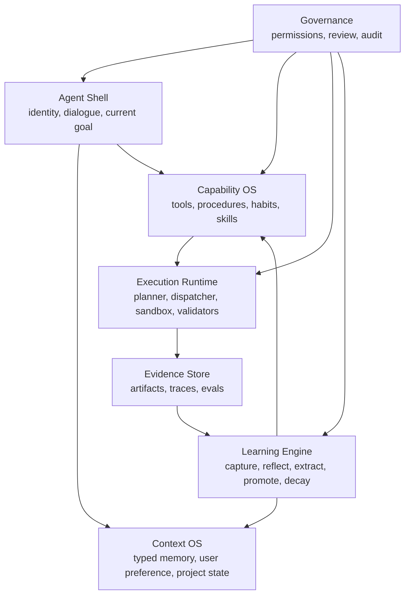

# Agent Usability and Learning Loop MVP（META-010）

Last reviewed: 2026-06-22

## 文档状态

- Document type: implementation / architecture
- Workstream: `META-010`
- Document status: confirmed
- Implementation status: implementing
- Authority scope: 按最新产品架构重开发 OmniAgent 的首个开发契约
- Source architecture: [`docs/product-architecture.md`](../../product-architecture.md)
- Supersedes: `META-009` Runtime 分层执行与性能优化专项作为当前开发主线

本文是 OmniAgent 按最新产品架构重新开发的 active workstream。旧阶段开发文档已归档到 `docs/archive/pre-product-redesign/`，只作为历史和迁移参考，不再作为当前实现目标。

## 目标

把 OmniAgent 从 task-centric runtime 推进到 learning-loop-centered general-purpose personal Agent OS 的最小可用版本。

本 workstream 的实现和验收不应被解释为代码助手专用路线。开发维护任务可以作为早期高频场景，但目标能力必须能迁移到文件整理、信息归纳、文档生成、数据处理、网页信息获取、任务规划和轻量自动化等通用个人任务。

首期不追求完整多入口、多 Agent 或生产化 UI，而是先证明一个核心闭环：

```text
User goal
  -> Agent state
  -> Context OS
  -> Capability OS
  -> Execution Runtime
  -> Evidence Store
  -> Learning Engine
  -> Procedure / habit reuse
```

用户可感知的结果：

- Agent 能维护当前目标、项目状态、用户偏好和自身能力边界。
- Agent 能先识别任务类型、风险等级、所需工具和验证方式，而不是默认进入代码修改流程。
- 每次任务结束后都有结构化 experience record。
- 重复任务能先命中 procedure memory，而不是每次重新完整规划。
- 学习升级必须基于 evidence，不允许把一次偶然成功直接升级成 skill。
- 用户能查看 Agent 学到了什么，并能禁用或修正不合适的学习结果。

## 非目标

- 不在首期做 Web UI / Desktop App / Mobile / messaging 多入口。
- 不重写所有 executor 和 builtin skill。
- 不把旧 runtime 全部删除；先把它下沉为 Execution Runtime。
- 不把更多 builtin skill 当作智能提升主线。
- 不引入远端服务、多用户、多租户或默认联网能力。
- 不允许未验证的学习结果自动改变高风险行为。

## 旧系统关系

| 旧系统部分 | 新架构角色 | 处理策略 |
|---|---|---|
| `runtime.py` / `execution_engine.py` / `dispatcher.py` | Execution Runtime | 保留并下沉为执行层 |
| `execution_policy.py` | Decision-depth policy seed | 扩展为 procedure / habit fast path 的策略入口 |
| `memory.py` / `graph_memory.py` / `hybrid_memory.py` / `vector_recall.py` | Context OS seed | 从 recall 升级为 typed memory |
| `workflow_compiler.py` | Procedure extraction seed | 改造为 experience -> procedure draft 的提炼器 |
| `skill_lifecycle.py` / `skill_auto_generation.py` | Skill promotion seed | 只在 habit 稳定后进入 skill promotion |
| `workspace/tasks/` / `eval_runs/` / diagnostics | Evidence Store seed | 统一 evidence schema，用于学习升级和回归验证 |
| `ARCHITECTURE.md` | Current-state inventory | 迁移输入，不再作为目标产品架构 |

## 验收矩阵

| Product architecture rule | Implementation target | Evidence needed | Status |
|---|---|---|---|
| Agent 先维护当前目标，而不是只接收单条 task | `AgentState` / `CurrentGoal` 持久化与读取 | `tests/test_agent_state.py`；CLI / REPL 能显示 active goal；任务 context 写入 state summary | implemented |
| Agent 有稳定 self model，知道能力边界和不确定性 | `AgentProfile` / `CapabilitySelfModel` | `workspace/agent_state/agent_profile.json`；`AGENT_STATE.md` 摘要进入 bootstrap documents | implemented |
| 用户偏好是一等输入 | `UserPreference` typed memory | 偏好写入、读取、禁用测试；任务上下文能注入偏好摘要且排除 disabled preference | implemented |
| 项目状态是一等输入 | `ProjectState` typed memory | `workspace/agent_state/project_state.json` 可从项目文档建立当前 workstream 和权威文档列表 | implemented |
| Agent 执行前能识别任务类型、风险、工具和验证方式 | `TaskIntakeAssessment` artifact | `src/omniagent/task_intake.py`；每个任务写 `workspace/tasks/<task_id>/plan/intake_assessment.json`；runtime 在正式 `task.created` 前发布 `task.intake_assessed`，CLI 非 JSON 事件流提前输出 `任务预判`，结束摘要也包含同一 intake；real-world eval runner 收集 `task_intake_assessments` 并支持 intake / experience / policy risk / LLM prompt 断言；`tests/test_task_intake.py` 与 `tests/test_real_world_eval_diagnostics.py::test_task_intake_assertions_use_collected_assessment` 覆盖；`general_agent_usability_*` 首批 5 类学习序列、5 个自然语言 tool-choice 场景和 5 个权限边界场景已加入，通过 `--check-only`，并在离线 `OMNIAGENT_LLM_PROVIDER=test` 基线下跑通 | verified_offline |
| 每次任务结束后记录 experience | `ExperienceRecord` schema and writer | runtime success / failure / permission denied 路径写 record；包含 goal、actions、artifacts、validation、failure attribution | implemented |
| 学习发生在验证之后 | `LearningEngine` promotion gate | `ExperienceRecord` 只在 `validation.verdict = passed` 时生成需审核的 procedure candidate；未验证、partial、failed 或缺少 evidence 的记录不生成 procedure draft；`tests/test_experience_record.py::ExperienceRecordIntegrationTest::test_success_without_validation_does_not_create_procedure_candidate` 和 `tests/test_procedure_memory.py::ProcedureMemoryStoreTest::test_extract_draft_requires_passed_validation_with_evidence` 覆盖该 gate | implemented |
| 经验可提炼成 procedure draft | `ProcedureDraft` model and extractor | 从 passed `ExperienceRecord` 生成 draft；包含 trigger、steps、outputs、validator、risk 和 source experience lineage | implemented |
| procedure 可在下次任务前被检索和建议 | `ProcedureMemory` retrieval | 相似任务命中 procedure；`procedure_match.json` 记录命中原因、置信度、拒绝候选和确认要求 | implemented |
| verified procedure 可优先于 full planning | Procedure runner before Planner | `tests/test_procedure_memory.py::ProcedureMemoryRuntimeIntegrationTest::test_runtime_writes_accepted_habit_fast_path_artifact`；policy artifact 记录 `habit_fast_path` 和 skipped stages | implemented |
| habit fast path 只来自多次验证成功 | Habit promotion rules | `tests/test_procedure_memory.py::ProcedureMemoryStoreTest::test_habit_promotion_requires_three_verified_successes`；失败降级、连续失败禁用和高风险确认测试 | implemented |
| skill promotion 只发生在 habit 稳定后 | `SkillLifecycle` promotion source change | `tests/test_skill_lifecycle.py::SkillLifecycleIntegrationTest::test_habit_promotes_to_active_skill_with_lineage_and_contract`；workflow-first promotion 被 habit gate 阻断 | implemented |
| 用户可查看和修正学习内容 | CLI / REPL management commands | `procedure list/show/edit/review/disable/explain-match/promote-habit`、`skill promote-habit/show --json`、`learning review --type experience/procedure/habit/skill`、`learning show --type experience/procedure/habit/skill`、`learning history --type experience/procedure/habit/skill`、`learning explain-match <task_or_goal>`、`learning edit --type procedure|habit`、`learning promote --type procedure|habit`、`learning validate --type procedure|habit|skill`、`learning decay --type procedure|habit`、`learning request-changes --type procedure|habit`、`learning approve --type procedure|habit|skill`、`learning reject --type procedure|habit|skill`、`learning disable --type procedure|habit|skill`、`learning enable --type procedure|habit|skill` 和 `learning rollback --type skill` 已覆盖；learning history 暴露 experience recorded / validated、procedure audit / review 和 skill lifecycle / lineage 事件流；learning explain-match 暴露 procedure / habit retrieval 的 matched item、rejected candidates、confirmation / suggestion mode；procedure / habit 行为字段编辑会撤回自动复用资格并要求复审，learning promote 复用 procedure -> habit 和 habit -> skill promotion gate，learning validate 复用 procedure review gate 或 skill lifecycle validation gate，learning decay 撤回 procedure / habit 自动复用资格并标记 fresh evidence review，learning request-changes 复用 procedure `needs_changes` review gate，learning approve / reject 复用 procedure review gate 或 skill approval record，skill disable 走 lifecycle deprecate，skill enable 复用 activation gate，skill rollback 复用 lifecycle rollback gate | implemented |
| 任务结束回复能让用户感知学习结果 | Learning feedback output | `docs/specs/learning-feedback.md`；`TaskExecutionReport.learning_feedback`、`workspace/tasks/<task_id>/learning/feedback.json`、CLI 非 JSON `学习反馈` 区块和 chat responder 追加反馈；`tests/test_learning_feedback.py` 与 `tests/test_responder_validation.py::ResponderIntegrationTest::test_learning_feedback_injected_and_appended_to_reply` 覆盖 draft review、habit fast path 和修正入口；`learning_loop_feedback_sequence` 真实评测覆盖 draft -> approved procedure -> verified reuse -> habit fast path -> explain-match -> edit -> disable，`learning_feedbacks` 已进入 evidence index / dashboard | verified |
| 复用失败后能纠错、冻结并用新证据恢复 | Learning correction loop | `docs/specs/learning-correction.md`；runtime 在 matched procedure / habit validator failure 后写 `workspace/tasks/<task_id>/learning/correction.json`，将旧对象标记 `correction_required`、降级或禁用，并让 explain-match 拒绝自动复用；`tests/test_procedure_memory.py`、`tests/test_learning_feedback.py` 和 `tests/test_real_world_eval_diagnostics.py` 覆盖 correction artifact、rejected candidates、fresh evidence approval restore、evidence index 和 Learning Correction Cases dashboard；`learning_loop_correction_recovery` 真实评测在 `eval_runs/20260616_020213/` 通过 | verified |
| 高风险行为仍受权限治理 | `PermissionManager` + learning governance | `tests/test_execution_policy.py::ExecutionPolicyTest::test_habit_candidate_does_not_bypass_static_risk_gate` 和 `tests/test_procedure_memory.py::ProcedureMemoryRuntimeIntegrationTest::test_runtime_high_risk_habit_requires_confirmation_and_no_fast_path`；高风险 habit match 仍需确认，policy artifact 不会接受 fast path | implemented |
| Evidence Store 支撑学习和回归验证 | Unified evidence schema | `experience_record.json`、`procedure_match.json`、`habit_fast_path.json`、`learning/correction.json`、`policy_decision.json`、`lineage.json` 和 skill lifecycle records 已形成 Phase 1-7 evidence chain；`run_real_world_evals.py --build-evidence-index` 可汇总跨 eval evidence，并在 index JSON `summary` / Markdown summary 中展示 status / scenario / category / requires / skip reason / failure layer 分布，同时索引 case status / scenario / category / requires / skip reason、`procedure_memory_records` lifecycle / review / audit / approval / promotion / edit / request-changes / decay / disable / restore / rejection evidence、`learning_corrections` validator failure / frozen / review status evidence 与 `skill_lifecycle_records` validation / approval / promotion / disable / restore / rollback / rejection / registration evidence；`--query-evidence-index` 可按 failure layer、skill、procedure / habit / lineage、scenario、promotion generation type、promotion source target、category、requires、skip reason、permission summary、completion evaluation failure layer、ExecutionPolicy policy decision、ExecutionPolicy skipped stage、ExecutionPolicy risk flag、ExecutionPolicy reason、ExecutionPolicy context budget、LLM request payload stats、TaskGraph node status、Critic action、memory retrieval / embedding signal、run-level LLM provider / model、LLM usage / token / duration signal、learning evidence kind、learning validation evidence、skill validation status、procedure / habit review decision 和 audit event 输出回归报告视图；`--evidence-dashboard` 可生成失败修复入口、regression commands（含 failed scenario rerun、eval coverage status / scenario / category / requires / skip reason、used skill、procedure id / habit id、lineage skill、promotion generation type / source target、permission summary、policy reason、policy context budget / request payload stats 高水位、learning kind / learning validation / skill validation / review decision / audit event 动态查询）、eval coverage、skipped eval、model capability、node execution、critic action、completion evaluation、memory retrieval、LLM usage、runtime cost hotspot、execution policy、Planner skipped、policy risk flag、policy reason、policy context budget、request payload stats、permission governance、habit fast path、learning match explanation、learning gate、learning feedback、learning correction、learning governance、learning history、learning approval、learning promotion、learning validation、learning edit、learning request-changes、learning decay、learning disable、learning restore、learning rollback、learning rejection、learning audit gap、skill lifecycle governance、skill promotion coverage、skill approval gate 和 learning lineage 回归看板；`--evidence-dashboard-commands-output` 可单独落盘可复制命令清单 | verified |

## 目标模块边界



## 实施阶段

### Phase 0: Spec and migration baseline

- 确认本文件为 `META-010` active workstream。
- 旧开发文档归档，`META-009` 不再作为当前主线。
- 建立新架构术语和状态 schema 的最小 spec。
- 给现有 runtime 写迁移映射，不先重写代码。

Exit criteria:

- Registry、README、ROADMAP、AGENTS 都指向 `META-010`。
- 旧过程文档在 archive 中可追溯。
- 验收矩阵可作为后续实现 checklist。

### Phase 1: Agent state

- 新增 `AgentProfile`、`UserPreference`、`ProjectState`、`CurrentGoal`。
- 选择存储位置和 schema，优先 workspace-local、可读可审计。
- 让 CLI / REPL 能查看当前 Agent state。

Exit criteria:

- 用户问当前项目状态时，Agent 可基于 state + docs 给出有证据的回答。（implemented）
- state 写入不依赖真实 LLM。（implemented）

Implementation evidence:

- `src/omniagent/agent_state.py`
- `omniagent state show` and REPL `/state [profile|preferences|project|goal]`
- `workspace/tasks/<task_id>/context_snapshot.json` contains `agent_state_summary`
- `workspace/tasks/<task_id>/plan/policy_decision.json` contains `agent_state_summary`
- `poetry run python -m pytest tests/test_agent_state.py`

### Phase 2: Experience records

- 每次任务结束后写入 `ExperienceRecord`。
- 成功、失败、取消、权限拒绝都要记录。
- 记录必须引用 artifacts / diagnostics / validation evidence。

Exit criteria:

- 任意任务都有可回放 experience。（implemented for success / failure / permission denied / blocked run attempts）
- failure attribution 能进入后续学习判断。（implemented as `failure_pattern` learning candidates）

Implementation evidence:

- `src/omniagent/experience.py`
- `workspace/tasks/<task_id>/experience/experience_record.json`
- `workspace/experience/index.jsonl`
- `tests/test_experience_record.py::ExperienceRecordIntegrationTest::test_success_without_validation_does_not_create_procedure_candidate` validates that a succeeded but unverified experience does not produce a procedure candidate or draft.
- `poetry run python -m pytest tests/test_experience_record.py`

### Phase 3: Procedure memory

- 从 experience 提炼 `ProcedureDraft`。
- procedure 包含 trigger、steps、inputs、outputs、validator、risk。
- 下次相似任务先检索 procedure，再决定执行、建议或回退 Planner。

Exit criteria:

- 低风险文件任务有 procedure retrieval 集成验证。（implemented）
- diagnostics 能解释为什么命中或不命中 procedure。（implemented via `procedure_match.json`）

Implementation evidence:

- `src/omniagent/procedure_memory.py`
- `workspace/procedures/drafts/<procedure_id>.json`
- `workspace/procedures/index.jsonl`
- `workspace/tasks/<task_id>/procedure/procedure_match.json`
- `omniagent procedure edit <procedure_id> --patch '{...}'` and `omniagent procedure review <procedure_id> --decision approved --evidence-ref <ref>` expose correction and review gates.
- `tests/test_procedure_memory.py::ProcedureMemoryStoreTest::test_extract_draft_requires_passed_validation_with_evidence` validates that procedure draft extraction requires `validation.verdict = passed` and non-empty validation evidence.
- `poetry run python -m pytest tests/test_procedure_memory.py`

### Phase 4: Habit fast path

- 多次验证成功的 procedure 可升级为 habit。
- habit 可走 fast path，但必须保留 validator 和权限 gate。
- 失败后 habit 降级或暂停。

Exit criteria:

- 低风险重复任务能少走 full Planner。
- skipped stage、validator evidence 和 habit id 都进入 artifact。

Implementation evidence:

- `ProcedureMemoryStore.promote_to_habit(...)` enforces verified status, 3 successes, no recent failures, and explicit confirmation for high-risk habits.
- `workspace/tasks/<task_id>/procedure/habit_fast_path.json` records habit id, skipped stages, validator evidence refs, required permissions, and policy gate outcome.
- `workspace/tasks/<task_id>/plan/policy_decision.json` includes the final `habit_fast_path` policy result.
- `omniagent procedure promote-habit <procedure_id>` exposes the promotion gate.
- `tests/test_procedure_memory.py::ProcedureMemoryRuntimeIntegrationTest::test_runtime_high_risk_habit_requires_confirmation_and_no_fast_path` validates that high-risk habit matches produce `planner_required`, keep `skipped_stages=[]`, and are not accepted by the policy gate.
- `poetry run python -m pytest tests/test_procedure_memory.py tests/test_execution_policy.py`

### Phase 5: Skill promotion

- 只有稳定 habit 才进入 skill promotion。
- skill 必须有 manifest、contract、测试或验证脚本、权限边界。
- skill 版本升级来自失败修正或环境变化。

Exit criteria:

- 至少一个 skill 可追溯到 experience -> procedure -> habit -> skill。
- 用户可查看该 skill 的 evidence lineage。

Implementation evidence:

- `docs/specs/skill-promotion.md`
- `SkillLifecycleManager.promote_habit_to_skill(...)` only accepts stable habit procedures.
- `omniagent skill promote-habit <procedure_id>` creates a skill package with `skill.yaml`, `main.py`, `tests/test_skill.py`, `README.md`, and `lineage.json`.
- `skill.yaml.contracts` and registry contracts expose action-level input requirements and side effects.
- File, JSON / JSONL data (including jsonl / ndjson aliases), CSV / TSV data, SQLite data, config, plain text, markdown, HTML, archive (including zip / tar / gztar / tgz / tar.gz aliases) and datetime habits can be promoted as low-risk generated skills; read-only Git and safe shell habits can be promoted as process-backed validated skills, Python habits can be promoted as code-execution-backed validated skills, and HTTP / browser fetch habits can be promoted as network-backed validated skills that require manual approval before activation; source habit `medium` / `high` risk blocks automatic approval and activation.
- Active low-risk `generated.habit.*` skills can use `ExecutionPolicy` direct execute when explicit structured payload passes the existing contract / permission / side-effect / path / risk gates; high-risk, inactive, network, code execution, system exec, dependency install and delete paths still require Planner / approval gates.
- `skill show --json` returns `lineage_records`.
- `workflow promote` no longer creates an active skill directly; it records `solidification_result=blocked_requires_habit`.
- `omniagent learning review` provides a unified read-only audit view across experience, procedure, habit, and skill learning objects, including review status, risk, findings, and lineage.
- `omniagent learning show --type experience|procedure|habit|skill <id>` provides single-object detail with the audit item and raw object payload.
- `omniagent learning history --type experience|procedure|habit|skill <id>` provides a unified object history stream across recorded / validated experience events, procedure audit / review events, and skill lifecycle / lineage events.
- `omniagent learning explain-match <task_or_goal>` provides a unified learning governance explanation over procedure / habit retrieval, including matched audit item, rejected candidate items, confirmation requirement, and suggestion mode.
- `omniagent learning edit --type procedure|habit <id> --patch '{...}'` provides a unified object-level edit operation for procedure memory objects; it reuses the procedure edit gate and downgrades edited habits to draft review when behavior-affecting fields change.
- `omniagent learning promote --type procedure|habit <id>` provides a unified object-level promotion operation for procedure -> habit and habit -> skill transitions; it reuses existing promotion gates and exposes target type, target id, validation, approval, and registration evidence.
- `omniagent learning decay --type procedure|habit <id>` provides a unified object-level decay operation for stale procedure memory objects; it downgrades procedure objects to draft review, downgrades habit objects to verified review, resets old success / failure counters, caps confidence, writes a `decayed` audit event, and requires fresh evidence refs before approval can clear `decayed_requires_review`.
- `omniagent learning request-changes --type procedure|habit <id>` provides a unified object-level needs-changes review operation for procedure memory objects; it reuses the procedure review gate and downgrades verified procedure / habit objects to draft review.
- `omniagent learning validate --type procedure|habit|skill <id>` provides a unified object-level validation operation; procedure / habit validation reuses the procedure review gate with approved evidence refs, while skill validation reuses the skill lifecycle validation gate and returns validation report, approval policy, optional approval record, previous status, target version, and updated audit item without activating the skill.
- `omniagent learning approve --type procedure|habit|skill <id>` provides a unified object-level approval operation; procedure / habit approval reuses the procedure review gate, while skill approval writes a lifecycle approval record without bypassing activation.
- `omniagent learning reject --type procedure|habit|skill <id>` provides a unified object-level rejection operation; procedure / habit rejection reuses the procedure review gate, while skill rejection writes a rejected lifecycle approval record without activation.
- `omniagent learning disable --type procedure|habit|skill <id>` provides a unified object-level governance operation for disabling procedure memory, habit fast-path candidates, and skill learning objects; disabled former habits remain visible in habit review/show when `--include-disabled` is used, while skill disable maps to lifecycle deprecate.
- `omniagent learning enable --type procedure|habit|skill <id>` restores disabled procedure / habit learning objects from their disable audit note and reactivates deprecated skill learning objects through the normal lifecycle activation gate.
- `omniagent learning rollback --type skill <skill_name> --to-version <version>` provides a unified object-level rollback operation for skill learning objects; it reuses the skill lifecycle rollback gate and returns previous version, target version, registration evidence, and the updated audit item.
- `poetry run python -m pytest tests/test_skill_lifecycle.py tests/test_skill_auto_generation.py::AutoSkillGenerationIntegrationTest::test_workflow_promotion_requires_habit_before_skill_generation`
- `tests/test_skill_lifecycle.py::SkillLifecycleIntegrationTest::test_habit_promotes_to_active_skill_with_lineage_and_contract` validates file habit promotion with generated `list` / `read` / `write` / `append` / `replace_line` / `copy` contracts and runtime replace-line / copy execution.
- `tests/test_skill_lifecycle.py::SkillLifecycleIntegrationTest::test_jsonl_habit_promotes_as_json_skill_and_executes_line_query` validates JSONL target alias promotion, generated `query_lines` / `report_lines` contracts, runtime line query, report file writing, and `source_targets=["jsonl"]` lineage.
- `tests/test_execution_policy.py::ExecutionPolicyTest::test_low_risk_generated_habit_skill_can_direct_execute` validates active low-risk generated habit skill direct execution, with sibling tests covering permission and inactive-status rejection.
- `tests/test_skill_lifecycle.py::SkillLifecycleIntegrationTest::test_sqlite_habit_promotes_to_active_skill_and_executes_query` validates SQLite data habit promotion with read-only query execution.
- `tests/test_skill_lifecycle.py::SkillLifecycleIntegrationTest::test_config_habit_promotes_to_active_skill_and_executes_query` validates config habit promotion with `yaml` / `yml` / `toml` / `xml` target aliases and YAML query execution.
- `tests/test_skill_lifecycle.py::SkillLifecycleIntegrationTest::test_xml_config_habit_promotes_to_active_skill_and_executes_query` validates XML config habit promotion and generated XML query execution.
- `tests/test_skill_lifecycle.py::SkillLifecycleIntegrationTest::test_dotenv_config_habit_promotes_to_active_skill_and_executes_query` validates dotenv config habit promotion and generated key-value config execution for dotenv, INI, and properties files.
- `tests/test_skill_lifecycle.py::SkillLifecycleIntegrationTest::test_text_habit_promotes_to_active_skill_and_executes_line_extract` validates plain text habit promotion with generated `stats` / `extract_lines` / `replace` / `report` contracts and runtime line extraction.
- `tests/test_skill_lifecycle.py::SkillLifecycleIntegrationTest::test_html_habit_promotes_to_active_skill_and_executes_report` validates HTML habit promotion with generated `extract` / `links` / `report` contracts.
- `tests/test_skill_lifecycle.py::SkillLifecycleIntegrationTest::test_archive_habit_promotes_to_active_skill_and_executes_create` validates archive habit promotion with generated `list` / `extract` / `create` contracts, `tgz` target alias detection, `gztar` / tar.gz creation, and traversal-protected extraction.
- `tests/test_skill_lifecycle.py::SkillLifecycleIntegrationTest::test_datetime_habit_promotes_to_active_skill_and_executes_format` validates datetime habit promotion with generated `now` / `parse` / `format` / `diff` / `add` contracts and no extra permission requirements.
- `tests/test_skill_lifecycle.py::SkillLifecycleIntegrationTest::test_git_habit_promotes_to_validated_skill_and_requires_manual_approval` validates read-only Git habit promotion with generated `status` / `diff` / `log` / `show` contracts, `system.exec` / `process` permission boundary, validation-only lifecycle status, and manual approval before runtime execution.
- `tests/test_skill_lifecycle.py::SkillLifecycleIntegrationTest::test_python_habit_promotes_to_validated_skill_and_requires_manual_approval` validates Python habit promotion with generated `run` contract, `code_execution` / `python_execution` permission boundary, validation-only lifecycle status, and manual approval before L3 sandbox `run_python` execution.
- `tests/test_skill_lifecycle.py::SkillLifecycleIntegrationTest::test_http_habit_promotes_to_validated_skill_and_requires_manual_approval` validates HTTP habit promotion with generated `get` / `post` / `put` / `delete` contracts, `network` permission boundary, validation-only lifecycle status, and manual approval before runtime execution.
- `tests/test_skill_lifecycle.py::SkillLifecycleIntegrationTest::test_browser_habit_promotes_to_validated_skill_and_requires_manual_approval` validates browser fetch habit promotion with generated `fetch` contract, `network` permission boundary, validation-only lifecycle status, captcha / access-denial guard, and manual approval before runtime execution.
- `tests/test_skill_lifecycle.py::SkillLifecycleIntegrationTest::test_shell_habit_promotes_to_validated_skill_and_requires_manual_approval` validates safe shell habit promotion with generated `run` contract, command whitelist, argv / `shell=False`, `system.exec` / `process` permission boundary, validation-only lifecycle status, and manual approval before runtime execution.
- `poetry run python -m pytest tests/test_learning_governance.py`
- `tests/test_learning_governance.py::LearningGovernanceIntegrationTest::test_learning_review_includes_experience_audit_items` validates experience review status, findings, and lineage.
- `tests/test_learning_governance.py::LearningGovernanceIntegrationTest::test_cli_learning_review_filters_habit_items` validates habit review status, promotion candidate health, and lineage filtering.
- `tests/test_learning_governance.py::LearningGovernanceIntegrationTest::test_cli_learning_show_outputs_experience_detail` validates single-object detail output for experience records.
- `tests/test_learning_governance.py::LearningGovernanceIntegrationTest::test_cli_learning_edit_controls_procedure_and_habit_objects` validates unified procedure and habit editing over the procedure edit gate, including habit downgrade to draft review after behavior-affecting edits.
- `tests/test_learning_governance.py::LearningGovernanceIntegrationTest::test_cli_learning_promote_controls_procedure_and_habit_objects` validates unified procedure -> habit and habit -> skill promotion over the existing promotion gates.
- `tests/test_learning_governance.py::LearningGovernanceIntegrationTest::test_cli_learning_validate_controls_procedure_habit_and_skill_objects` validates unified procedure / habit validation over the procedure review gate and skill validation over the existing lifecycle validation gate, including previous status, evidence refs, target version, validation report, approval policy, optional approval record, and skill history event.
- `tests/test_learning_governance.py::LearningGovernanceIntegrationTest::test_cli_learning_decay_controls_procedure_and_habit_objects` validates unified procedure and habit decay, including audit records, count reset, review status, decayed former habit visibility in procedure review, and fresh-evidence enforcement before approval.
- `tests/test_learning_governance.py::LearningGovernanceIntegrationTest::test_cli_learning_request_changes_controls_procedure_and_habit_objects` validates unified procedure and habit request-changes review, including downgrade to draft, review queue visibility, and history events.
- `tests/test_learning_governance.py::LearningGovernanceIntegrationTest::test_cli_learning_approve_controls_procedure_and_skill_objects` validates unified procedure approval and skill approval governance over existing review / lifecycle gates.
- `tests/test_learning_governance.py::LearningGovernanceIntegrationTest::test_cli_learning_reject_controls_procedure_habit_and_skill_objects` validates unified procedure, habit, and skill rejection governance over existing review / lifecycle gates.
- `tests/test_learning_governance.py::LearningGovernanceIntegrationTest::test_cli_learning_disable_and_enable_controls_learning_objects` validates unified procedure / habit / skill disable and enable operations, audit notes, disabled habit review visibility, skill lifecycle deprecation, and lifecycle-gated skill reactivation.
- `tests/test_learning_governance.py::LearningGovernanceIntegrationTest::test_cli_learning_rollback_controls_skill_object` validates unified skill rollback governance over the existing lifecycle rollback gate, including previous version, target version, registration record, and updated skill detail.
- `tests/test_learning_governance.py::LearningGovernanceIntegrationTest::test_cli_learning_history_outputs_audit_events` validates unified learning history output for experience recorded / validated events, habit procedure audit / review events, and skill lifecycle / lineage events.
- `tests/test_learning_governance.py::LearningGovernanceIntegrationTest::test_cli_learning_explain_match_outputs_habit_audit_context` validates unified learning explain-match over habit retrieval, matched audit item, and disabled rejected candidate context.
- `poetry run python scripts/run_real_world_evals.py --scenario learning_loop_habit_promoted_skill_lineage` -> `eval_runs/20260612_034828/` passed
- `poetry run python scripts/run_real_world_evals.py --scenario learning_loop_jsonl_habit_promoted_skill_lineage` -> `eval_runs/20260613_042808/` passed; policy artifact shows `direct_execute`, `skipped_stages=["planner"]`, used skill `generated.habit.eval_jsonl_events`, and `source_targets=["jsonl"]`.
- `poetry run python scripts/run_real_world_evals.py --query-evidence-index --evidence-failure-layer skill_or_tool` queries existing cross-run evidence by failure layer, skill, procedure, habit, skill lineage, promotion generation type, promotion source target, category, requires, skip reason, permission summary, completion evaluation failure layer, ExecutionPolicy policy decision, ExecutionPolicy skipped stage, ExecutionPolicy risk flag, ExecutionPolicy reason, ExecutionPolicy context budget, LLM request payload stats, TaskGraph node status, Critic action, memory retrieval / embedding signal, run-level LLM provider / model, LLM usage / token / duration signal, learning evidence kind, learning validation evidence, skill validation status, procedure / habit review decision, and audit event.
- `poetry run python scripts/run_real_world_evals.py --query-evidence-index --evidence-policy-decision direct_execute` queries existing cross-run evidence by `policy_decision` and summarizes `by_policy_decision`.
- `poetry run python scripts/run_real_world_evals.py --query-evidence-index --evidence-skipped-stage planner` queries existing cross-run evidence by skipped stage and summarizes `by_skipped_stage`.
- `poetry run python scripts/run_real_world_evals.py --query-evidence-index --evidence-policy-risk-flag planner_context_required` queries existing cross-run evidence by enabled policy risk / routing flag and summarizes `by_policy_risk_flag`.
- `poetry run python scripts/run_real_world_evals.py --query-evidence-index --evidence-policy-reason "*风险标记*"` queries existing cross-run evidence by policy reason text and summarizes `by_policy_reason`.
- `poetry run python scripts/run_real_world_evals.py --query-evidence-index --evidence-policy-context-budget "skill_registry_entries:json_chars:50000+"` queries existing cross-run evidence by policy context budget bucket and summarizes `by_policy_context_budget`.
- `poetry run python scripts/run_real_world_evals.py --query-evidence-index --evidence-request-payload-stats "skill_registry_entries:json_chars:10000-49999"` queries existing cross-run evidence by LLM request payload stats bucket and summarizes `by_request_payload_stats`.
- `poetry run python scripts/run_real_world_evals.py --query-evidence-index --evidence-node-status status:failed` queries existing cross-run evidence by TaskGraph node status signal and summarizes `by_node_status`.
- `poetry run python scripts/run_real_world_evals.py --query-evidence-index --evidence-critic-action action:accept` queries existing cross-run evidence by Critic verdict action signal and summarizes `by_critic_action`.
- `poetry run python scripts/run_real_world_evals.py --evidence-dashboard` writes `eval_runs/evidence_dashboard.md` with repair entry points, regression commands, eval coverage, skipped eval, model capability, node execution, critic action, completion evaluation, memory retrieval, LLM usage, runtime cost hotspot, execution policy, Planner skipped, policy risk flag, policy reason, policy context budget, request payload stats, permission governance, habit fast path, learning match explanation, learning gate, learning governance, learning history, learning approval, learning promotion, learning validation, learning edit, learning request-changes, learning decay, learning disable, learning restore, learning rollback, learning rejection, learning audit gap, skill lifecycle governance, generated habit skill usage, skill promotion coverage, skill approval gate, and learning lineage regression views; `--evidence-dashboard-commands-output` also writes a plain-text command list for direct regression consumption.
- `tests/test_real_world_eval_diagnostics.py::test_evidence_dashboard_builds_common_runbook_views` validates dashboard `regression_commands`, including scenario check, evidence-index rebuild, dashboard render, failed scenario rerun commands with required include flags, repair queries, deduplicated view query commands, eval coverage status / scenario / category / requires / skip reason dynamic query commands, used skill dynamic query commands, procedure / habit id dynamic query commands, lineage skill dynamic query commands, promotion generation type dynamic query commands, promotion source target dynamic query commands, permission summary dynamic query commands, completion layer non-`none` dynamic query commands, policy decision dynamic query commands, skipped stage dynamic query commands, policy risk flag dynamic query commands, policy reason dynamic query commands, policy context budget hotspot dynamic query commands, request payload stats hotspot dynamic query commands, node status view query commands, node status `status:*` / `attempts:*` / `error:*` dynamic query commands, critic action view query commands, critic action `action:*` dynamic query commands, memory retrieval view query commands, memory retrieval low-cardinality dynamic query commands, LLM usage view query commands, LLM usage low-cardinality token / duration / call-state dynamic query commands, learning evidence kind dynamic query commands, learning validation dynamic query commands, skill validation dynamic query commands, learning review decision view/dynamic query commands, and learning audit event view/dynamic query commands.
- `tests/test_real_world_eval_diagnostics.py::test_evidence_dashboard_builds_common_runbook_views` validates the fixed eval coverage dashboard view over case status、category、requires 和 skip reason evidence.
- `tests/test_real_world_eval_diagnostics.py::test_evidence_dashboard_builds_common_runbook_views` validates the fixed skipped eval dashboard view and coverage filters over category / requires / skip reason.
- `tests/test_real_world_eval_diagnostics.py::test_evidence_dashboard_cli_writes_regression_command_file` validates the CLI path that writes a standalone regression command file.
- `tests/test_real_world_eval_diagnostics.py::test_evidence_dashboard_builds_common_runbook_views` validates the fixed learning gate dashboard view over `experience_records`.
- `tests/test_real_world_eval_diagnostics.py::test_evidence_dashboard_builds_common_runbook_views` validates the fixed model capability dashboard view over `model_capability` failure evidence.
- `tests/test_real_world_eval_diagnostics.py::test_evidence_dashboard_builds_common_runbook_views` validates the fixed completion evaluation dashboard view over `completion_failure_layers` evidence and the `--evidence-completion-layer recorded` query command.
- `tests/test_real_world_eval_diagnostics.py::test_evidence_dashboard_builds_common_runbook_views` validates the fixed memory retrieval dashboard view over embedding summary / vector recall evidence and the `--evidence-memory-retrieval recorded` query command.
- `tests/test_real_world_eval_diagnostics.py::test_evidence_dashboard_builds_common_runbook_views` validates the fixed LLM usage dashboard view over `llm_call_count` / `llm_total_tokens` / `duration_seconds` evidence and the `--evidence-llm-usage llm_called` query command.
- `tests/test_real_world_eval_diagnostics.py::test_evidence_dashboard_builds_common_runbook_views` validates the fixed runtime cost hotspot dashboard view over `tokens:10000+` / `duration:60s+` evidence and the matching `--evidence-llm-usage` query command.
- `tests/test_real_world_eval_diagnostics.py::test_evidence_dashboard_builds_common_runbook_views` validates the fixed execution policy dashboard view over `policy_decisions` evidence and the `--evidence-policy-decision direct_execute` query command.
- `tests/test_real_world_eval_diagnostics.py::test_evidence_dashboard_builds_common_runbook_views` validates the fixed Planner skipped dashboard view over `policy_decisions[].skipped_stages` evidence and the `--evidence-skipped-stage planner` query command.
- `tests/test_real_world_eval_diagnostics.py::test_evidence_dashboard_builds_common_runbook_views` validates the fixed policy risk flag dashboard view over `policy_decisions[].risk_flags` evidence and the `--evidence-policy-risk-flag planner_context_required` query command.
- `tests/test_real_world_eval_diagnostics.py::test_evidence_dashboard_builds_common_runbook_views` validates the fixed policy reason dashboard view over `policy_decisions[].reason` evidence, the `--evidence-policy-reason "*"` query command, and exact policy reason dynamic regression commands.
- `tests/test_real_world_eval_diagnostics.py::test_evidence_dashboard_builds_common_runbook_views` validates the fixed policy context budget dashboard view over `policy_decisions[].context_budget` evidence, the `--evidence-policy-context-budget recorded` query command, and high-water budget bucket dynamic regression commands.
- `tests/test_real_world_eval_diagnostics.py::test_evidence_dashboard_builds_common_runbook_views` validates the fixed request payload stats dashboard view over LLM `request_payload_stats` evidence, the `--evidence-request-payload-stats recorded` query command, and high-water request payload bucket dynamic regression commands.
- `tests/test_real_world_eval_diagnostics.py::test_evidence_dashboard_builds_common_runbook_views` validates the fixed node execution dashboard view over TaskGraph `node_statuses` evidence and the `--evidence-node-status recorded` query command.
- `tests/test_real_world_eval_diagnostics.py::test_evidence_dashboard_builds_common_runbook_views` validates the fixed critic action dashboard view over Critic `critic_actions` evidence and the `--evidence-critic-action recorded` query command.
- `tests/test_real_world_eval_diagnostics.py::test_evidence_dashboard_builds_common_runbook_views` validates the fixed skill approval gate dashboard view over `generated.habit.*` cases with approval-sensitive permissions.
- `tests/test_real_world_eval_diagnostics.py::test_evidence_dashboard_builds_common_runbook_views` validates the fixed learning match explanation dashboard view over `procedure_matches`, including suggestion mode, confirmation requirement, and rejected candidate counts.
- `tests/test_real_world_eval_diagnostics.py::test_evidence_dashboard_builds_common_runbook_views` validates the fixed learning governance dashboard view over `procedure_memory_records` lifecycle / review / audit evidence and `skill_lifecycle_records` deprecate evidence.
- `tests/test_real_world_eval_diagnostics.py::test_evidence_dashboard_builds_common_runbook_views` validates the fixed learning history dashboard view over `experience_records`, `procedure_memory_records` audit / review evidence, and `skill_lifecycle_records` lifecycle events.
- `tests/test_real_world_eval_diagnostics.py::test_evidence_dashboard_builds_common_runbook_views` validates the fixed learning approval dashboard view over `procedure_memory_records` approved review evidence and `skill_lifecycle_records` approved approval evidence.
- `tests/test_real_world_eval_diagnostics.py::test_evidence_dashboard_builds_common_runbook_views` validates the fixed learning promotion dashboard view over `procedure_memory_records` promoted-to-habit audit evidence, `skill_lineages`, and habit-promotion lifecycle records.
- `tests/test_real_world_eval_diagnostics.py::test_evidence_dashboard_builds_common_runbook_views` validates the fixed learning validation dashboard view over procedure / habit `procedure_memory_records` approved review evidence plus `skill_lifecycle_records.validation_passed` and `skill_lifecycle_records.last_validated_at` evidence.
- `tests/test_real_world_eval_diagnostics.py::test_evidence_dashboard_builds_common_runbook_views` validates the fixed learning edit dashboard view over `procedure_memory_records` edited evidence, making procedure correction cases directly consumable outside broad governance.
- `tests/test_real_world_eval_diagnostics.py::test_evidence_dashboard_builds_learning_request_changes_view` validates the fixed learning request-changes dashboard view over `procedure_memory_records` needs_changes review evidence.
- `tests/test_real_world_eval_diagnostics.py::test_evidence_dashboard_builds_learning_decay_view` validates the fixed learning decay dashboard view over `procedure_memory_records` decayed audit evidence and `decayed_requires_review` review status.
- `tests/test_real_world_eval_diagnostics.py::test_evidence_dashboard_builds_common_runbook_views` validates the fixed learning disable dashboard view over current `procedure_memory_records` disabled audit evidence and `skill_lifecycle_records` deprecated lifecycle evidence, while keeping rejected former habits in the rejection view.
- `tests/test_real_world_eval_diagnostics.py::test_evidence_dashboard_builds_common_runbook_views` validates the fixed learning restore dashboard view over `procedure_memory_records` enabled audit evidence and `skill_lifecycle_records` deprecate -> activate evidence.
- `tests/test_real_world_eval_diagnostics.py::test_evidence_dashboard_builds_common_runbook_views` validates the fixed learning rollback dashboard view over `skill_lifecycle_records` rollback registration evidence.
- `tests/test_real_world_eval_diagnostics.py::test_evidence_dashboard_builds_common_runbook_views` validates the fixed learning rejection dashboard view over `procedure_memory_records` rejected review evidence and `skill_lifecycle_records` rejected approval evidence.
- `tests/test_real_world_eval_diagnostics.py::test_evidence_dashboard_builds_common_runbook_views` validates the fixed learning audit gap dashboard view over procedure / habit / skill lineage cases that are missing matching review, audit, validation, or lifecycle evidence.
- `tests/test_real_world_eval_diagnostics.py::test_evidence_dashboard_builds_common_runbook_views` validates the fixed skill lifecycle governance dashboard view over `skill_lifecycle_records` validation / approval / registration / registry evidence.
- `tests/test_real_world_eval_diagnostics.py::test_evidence_dashboard_builds_common_runbook_views` validates the fixed skill promotion coverage dashboard view over `skill_lineages.generation_type` / `skill_lineages.source_targets` and summarizes `by_promotion_generation_type` / `by_promotion_source_target`.

## 验证策略

- 单元测试覆盖 schema、promotion gate、permission gate。
- 集成测试覆盖 task -> experience -> procedure -> reuse。
- 真实场景评测新增 learning-loop case，不以旧 `META-009` 性能优化为主验收目标。
- 文档验收以本文件矩阵为准，每个完成项必须有 evidence path。

## 风险与控制

| Risk | Control |
|---|---|
| 学习内容污染后续行为 | draft / verified / habit / skill 分级，默认不能越级 |
| Agent 假装学会 | promotion 必须引用 evidence |
| 旧 runtime 复杂度拖累重开发 | 先下沉为 Execution Runtime，减少对产品层的侵入 |
| procedure 命中过度自信 | 置信度、risk、validator 和 fallback 全部记录 |
| 用户无法控制记忆 | 首期必须提供查看和禁用入口 |

## 当前下一步

1. 按真实稳定 habit 继续扩展更多 skill promotion 类型；file（含 replace_line / copy）、JSON / JSONL data（含 jsonl / ndjson alias 和 report_lines）、CSV / TSV data、SQLite data、config（含 YAML / TOML / XML / dotenv / INI / properties alias）、plain text、markdown、HTML、archive（含 zip / tar / gztar / tgz / tar.gz alias）和 datetime 已作为低风险自动激活类型支持；active 低风险 `generated.habit.*` 显式 payload 已可在 contract / permission / side-effect gate 下 direct execute；read-only Git 和 safe shell 已作为 process-backed 手动审批类型支持，Python 已作为 code-execution-backed 手动审批类型支持，HTTP 和 browser fetch 已作为 network-backed 手动审批类型支持，并保持高风险审批 gate。
2. 继续扩展学习治理到更多对象级别的操作入口；统一只读审计、对象详情、历史事件和匹配解释视图已覆盖 experience / procedure / habit / skill 与 procedure / habit retrieval，统一 edit / promote / validate / decay / request-changes 入口已覆盖 procedure / habit，统一 validate 入口已覆盖 skill，统一 rollback 入口已覆盖 skill，统一 approve / reject / disable / enable 入口已覆盖 procedure / habit / skill。
3. 将 evidence dashboard 接入更多回归消费入口；当前已能生成失败修复入口、regression commands（含 eval coverage status / scenario / category / requires / skip reason 动态查询、used skill 动态查询、procedure id / habit id 动态查询、lineage skill 动态查询、promotion generation type / source target 动态查询、permission summary 动态查询、completion layer 非 `none` 动态查询、policy decision / skipped stage / policy risk flag 动态查询、policy reason 动态查询、policy context budget / request payload stats 高水位动态查询、node status `status:*` / `attempts:*` / `error:*` 动态查询、critic action `action:*` 动态查询、memory retrieval 低基数状态动态查询、LLM usage 低基数 token / duration / call-state 动态查询、learning kind 动态查询、learning validation 动态查询、skill validation 动态查询、learning review decision 动态查询和 learning audit event 动态查询）、eval coverage、skipped eval、skill/tool failure、model capability、node execution、critic action、completion evaluation、memory retrieval、LLM usage、runtime cost hotspot、execution policy、Planner skipped、policy risk flag、policy reason、policy context budget、request payload stats、permission governance、habit fast path、learning match explanation、learning gate、learning feedback、learning governance、learning history、learning approval、learning promotion、learning validation、learning edit、learning request-changes、learning decay、learning disable、learning restore、learning rollback、learning rejection、learning audit gap、skill lifecycle governance、generated habit skill usage、skill promotion coverage、skill approval gate 和 learning lineage cases。
